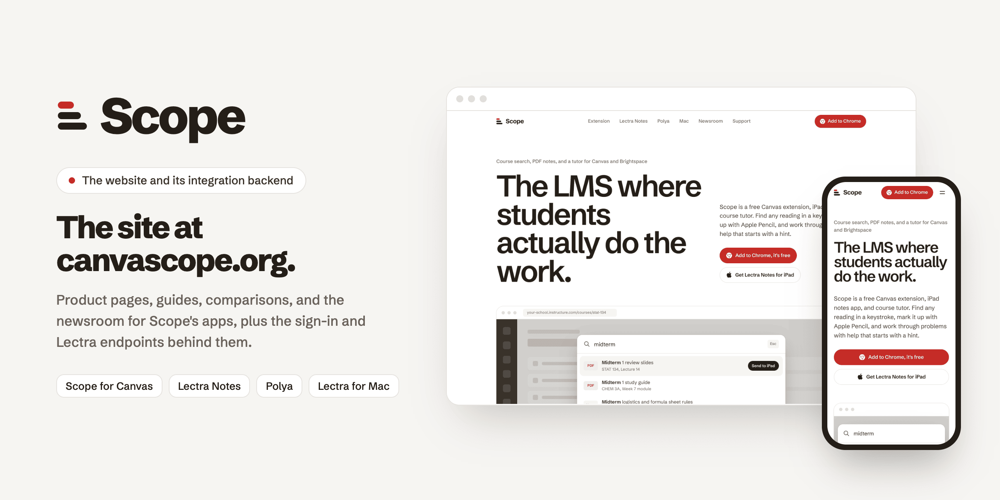
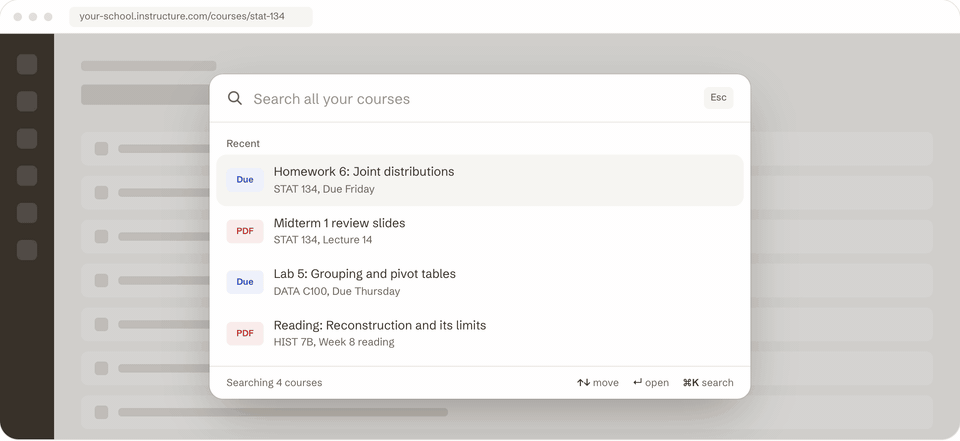
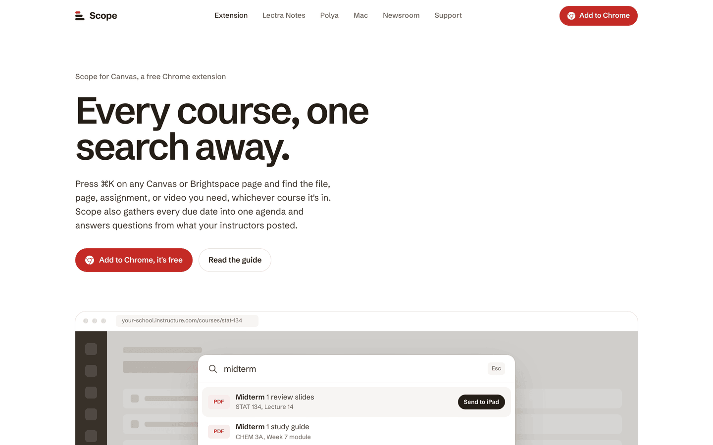
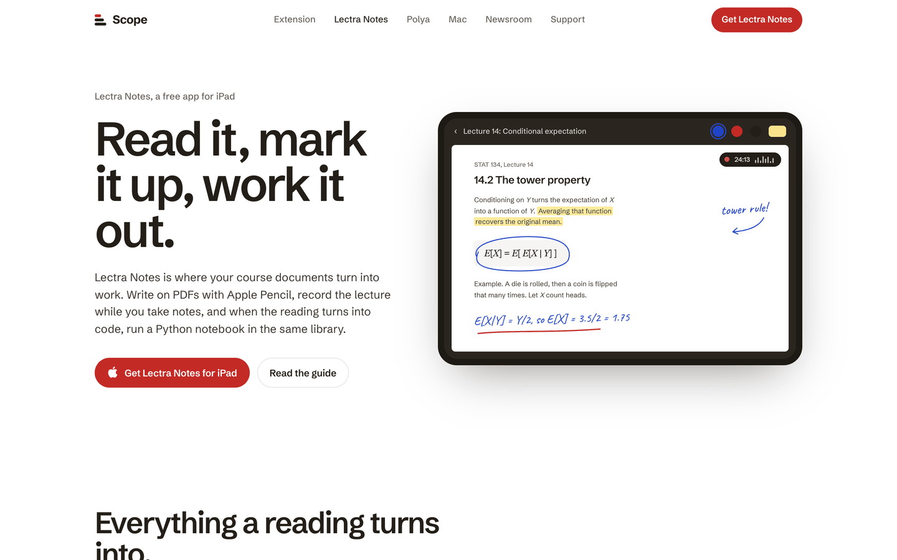
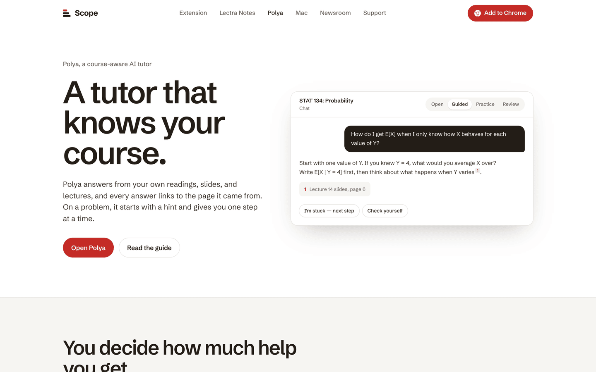
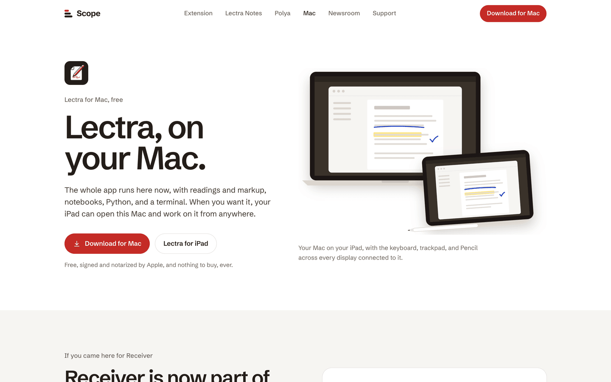
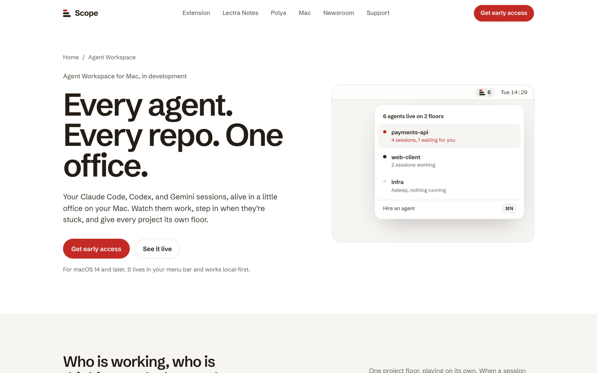
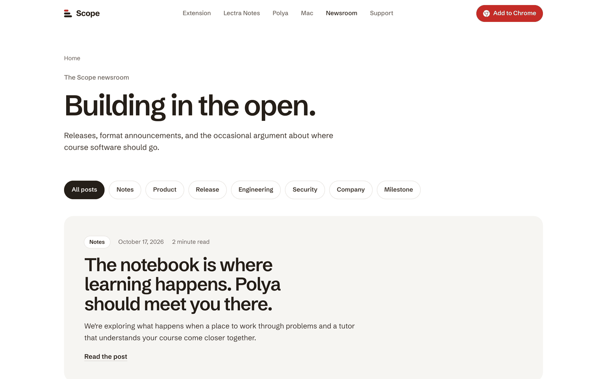
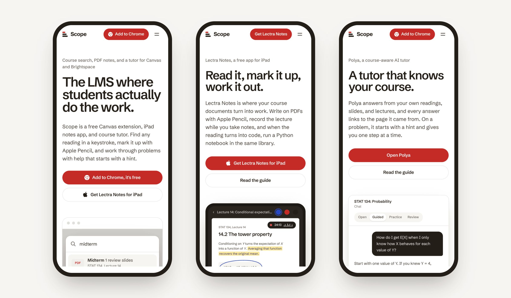
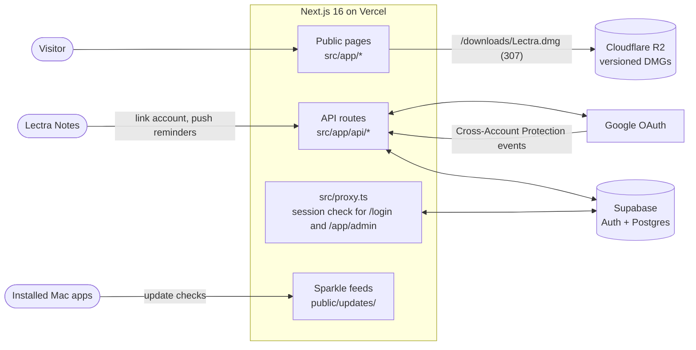

<p align="center">
  
</p>

<p align="center">
  <b>The public website and integration backend for Scope, served at canvascope.org.</b><br>
  It hosts the pages for Scope for Canvas, Lectra Notes, Polya, and Lectra for Mac, plus the endpoints that sign people in and link Lectra to a Scope account.
</p>

<p align="center">
  
  
  
  
  
  
  
</p>

<p align="center">
  <a href="#see-it-work">Demo</a> ·
  <a href="#the-pages">Pages</a> ·
  <a href="#design-decisions">Design decisions</a> ·
  <a href="#architecture">Architecture</a> ·
  <a href="#run-it">Run it</a> ·
  <a href="#docs">Docs</a>
</p>

> [!IMPORTANT]
> Two hard constraints on public copy. Nothing may claim an instructor product, gradebook, roster sync, or LMS replacement, because none of it is built. Nothing may offer a paid tier, because there isn't one. Students use the workspace free.

## What this site has to say

Scope is building the course workspace: the place students actually do the work, rather than the place assignments get posted. The site's job is to make that legible and route visitors to the right surface: Lectra Notes for iPad, the extension for the browser, and Polya for tutoring. Company direction lives in `../scope-docs/ROADMAP.md`.

> [!NOTE]
> **Naming.** Page copy and metadata are renamed to Scope. The remaining "Canvascope" strings in `src/app/layout.tsx` and in the `src/app/products/extension/page.tsx` keywords are **intentional** SEO keyword retention, so the former name still resolves. Leave them. The domain is still `canvascope.org`; changing it is a sequenced decision, not a find-and-replace.

## See it work

<p align="center">
  
</p>

<sub>Recorded with headless Chromium from the home page on a local dev server. The search demo on the page runs on sample courses, not a real Canvas account, and a script typed the queries.</sub>

The home page carries one interactive moment: a ⌘K search over a mock Canvas page. It shows what the Chrome extension does before anyone installs it. The demo lives in `src/components/command-palette-demo.tsx`.

## The pages

<table>
  <tr>
    <td width="50%"></td>
    <td width="50%"></td>
  </tr>
  <tr>
    <td valign="top"><b>1. Scope for Canvas</b> (<code>/products/extension</code>). The Chrome extension: search every Canvas and Brightspace course with ⌘K, one agenda for due dates, and Ask Scope for questions about the course.</td>
    <td valign="top"><b>2. Lectra Notes</b> (<code>/products/lectra</code>). The iPad app for Apple Pencil markup, lecture recording, and Python notebooks. <code>/notebooks</code> and <code>/code</code> go deeper.</td>
  </tr>
  <tr>
    <td width="50%"></td>
    <td width="50%"></td>
  </tr>
  <tr>
    <td valign="top"><b>3. Polya</b> (<code>/products/polya</code>). The course-aware tutor. Polya runs at askpolya.com, so every "Open Polya" button leaves this site for Polya's own sign-in.</td>
    <td valign="top"><b>4. Lectra for Mac</b> (<code>/mac</code>). The free Mac app that absorbed Lectra Receiver. <code>/receiver</code> renders the same page for links in shipped Receiver builds.</td>
  </tr>
  <tr>
    <td width="50%"></td>
    <td width="50%"></td>
  </tr>
  <tr>
    <td valign="top"><b>5. Agent Workspace</b> (<code>/products/agent-workspace</code>). A Mac app in development. Visitors join a waitlist through a form that posts to <code>/api/waitlist</code>.</td>
    <td valign="top"><b>6. Newsroom</b> (<code>/newsroom</code>). Releases, engineering notes, and announcements from the registry in <code>src/lib/newsroom.ts</code>, also published as RSS at <code>/feed.xml</code>.</td>
  </tr>
</table>

<sub>Screenshots from a local dev server at 1440 × 900, taken October 26, 2026.</sub>

The site also has comparison pages (`/compare`, eight articles), how-to guides (`/guides`, three articles), a page for connecting Scope to AI assistants (`/mcp`), and `/direction`, `/research`, `/press`, `/about`, `/support`, `/privacy`, and `/terms`.

Pages are built for phone width too. On October 26, 2026, all 87 pages in the sitemap fit a 390-pixel-wide screen without sideways scrolling.

<p align="center"></p>

## Design decisions

- **One design system for every public page.** White pages, warm ink, Scope red used sparingly, and Schibsted Grotesk throughout. Every page renders inside `PageShell`. [`docs/DESIGN.md`](docs/DESIGN.md) has the tokens and building blocks.
- **The product is the picture.** Pages show each app with drawn illustrations (`src/components/mocks/`) or real screenshots, and at most one orchestrated animation per page. Everything respects `prefers-reduced-motion`.
- **One definition per product.** `src/lib/site.ts` holds a one-sentence definition of each app. It's meant to appear word for word on the site, in `llms.txt`, in both store listings, and in every directory, so every surface agrees on what each product is.
- **Public pages never wait on Supabase.** `src/proxy.ts` checks a session only for `/login`, `/app/admin`, and OAuth returns that carry `?code=`. Product pages stay up when auth is down.
- **The user count is checked by hand.** `src/lib/usage.ts` commits the two counts and the date they were verified. A broken scrape can't make a page show zero.
- **Old links never 404.** `next.config.ts` redirects every retired path (`/product/*`, `/mission`, `/blog`, `/account`) because the Chrome Web Store listing, older posts, and shipped apps still link to them.
- **Mac downloads follow the update feed.** `/downloads/Lectra.dmg` is a temporary redirect to the newest build named in the Sparkle appcast. The build fails if no feed has a release, so the download button can't point at a missing file.
- **Comparisons name where the other app wins.** Each page in `/compare` is dated and sourced, and says what the competing app does better.

## Architecture



| Path | What it holds |
|---|---|
| [`src/app/`](src/app/) | Every page and API route (App Router), plus `feed.xml`, `llms.txt`, the sitemap, and Open Graph images |
| [`src/lib/site.ts`](src/lib/site.ts) | Product names, definitions, store and download URLs, and the support email. Pages read from here. |
| [`src/lib/compare.ts`](src/lib/compare.ts), [`guides.ts`](src/lib/guides.ts), [`newsroom.ts`](src/lib/newsroom.ts) | Registries that feed the hubs, sitemap, `llms.txt`, and each page's metadata |
| [`src/lib/seo.ts`](src/lib/seo.ts), [`structured-data.ts`](src/lib/structured-data.ts) | Per-page metadata and JSON-LD |
| [`src/components/site/`](src/components/site/) | `PageShell`, header, footer, and content primitives |
| [`src/components/mocks/`](src/components/mocks/) | Drawn product illustrations |
| [`next.config.ts`](next.config.ts) | Every legacy redirect (`/product/*`, `/mission`, `/blog`, `/apply`, `/app/authorize`) and the Lectra for Mac `/downloads/*` redirects derived from the appcast |
| [`public/updates/`](public/updates/) | The Sparkle feed that installed Mac copies poll |
| [`scripts/publish-receiver-release.sh`](scripts/publish-receiver-release.sh) | Publishes a Lectra for Mac release: uploads the DMG to R2 and copies the signed appcast here |
| [`supabase/migrations/`](supabase/migrations/) | Tables this site writes to, including `student_tasks` (reminders) and `agent_workspace_waitlist` |

### API routes

| Route | What it does |
|---|---|
| `/api/auth/google/start`, `/api/auth/google/callback` | Scope Google sign-in, kept in a signed `canvascope_session` cookie |
| `/auth/login`, `/auth/callback`, `/auth/signout` | Google sign-in through Supabase Auth |
| `/api/auth/session` | Reports the signed-in user from either session |
| `/api/integrations/lectra/*` | `bootstrap`, `link-token`, and `exchange` link Lectra to a Scope account; `reminders` accepts reminders from Lectra |
| `/api/reminders` | Lists reminders for the signed-in user |
| `/api/risc-receiver` | Forwards Google Cross-Account Protection events to the Supabase `risc-receiver` function |
| `/api/public/usage` | A cached, public usage aggregate. Returns `503` instead of a partial total. |
| `/api/internal/social-snapshot` | A bearer-token snapshot for the social automation |
| `/api/admin/metrics` | Activity counts for user IDs in `SCOPE_ADMIN_USER_IDS`; a 404 for everyone else |
| `/api/waitlist` | Agent Workspace waitlist sign-ups, with a honeypot, a time trap, and a per-instance rate limit |

## Run it

You need Node.js and npm.

```bash
npm install
npm run dev        # http://localhost:3000
npm run lint
npm run typecheck
npm run build      # fails if neither feed in public/updates/ has a release
```

There's no test suite. Lint, typecheck, and build are the checks.

The API routes read these variables from `.env.local` locally, or from the Vercel project in production. Never commit them.

| Variable | Used by |
|---|---|
| `NEXT_PUBLIC_SITE_URL` or `SITE_URL` | Absolute URLs and auth redirects |
| `NEXT_PUBLIC_SUPABASE_URL`, `NEXT_PUBLIC_SUPABASE_PUBLISHABLE_KEY` (or `_ANON_KEY`) | Supabase client; falls back to the project in `src/lib/supabase/config.ts` |
| `NEXT_PRIVATE_SUPABASE_SERVICE_ROLE_KEY` or `SUPABASE_SERVICE_ROLE_KEY` | Server-only Supabase access: waitlist, reminders, usage, and metrics |
| `CANVASCOPE_AUTH_BASE_URL`, `CANVASCOPE_SESSION_SECRET` | Scope Google sign-in; the secret is required in production |
| `GOOGLE_OAUTH_CLIENT_ID`, `GOOGLE_OAUTH_CLIENT_SECRET` | Scope Google sign-in |
| `SCOPE_ADMIN_USER_IDS` | Who can read `/api/admin/metrics` |
| `SOCIAL_SNAPSHOT_BEARER_TOKEN` | `/api/internal/social-snapshot` |
| `NEXT_PUBLIC_GOOGLE_SITE_VERIFICATION` | Google Search Console verification tag |

To ship a Lectra for Mac release, run `scripts/publish-receiver-release.sh` with the appcast from the `lectra-ios` build. It never commits. [`docs/RECEIVER_DISTRIBUTION.md`](docs/RECEIVER_DISTRIBUTION.md) explains the contract.

## Docs

- [`docs/DESIGN.md`](docs/DESIGN.md): the design system for public pages.
- [`docs/LECTRA_SCOPE_INTEGRATION.md`](docs/LECTRA_SCOPE_INTEGRATION.md): sign-in, Lectra linking, reminders, and the RISC receiver.
- [`docs/RECEIVER_DISTRIBUTION.md`](docs/RECEIVER_DISTRIBUTION.md): hosting Lectra for Mac downloads and update feeds.
- [`docs/ACTIVITY_METRICS.md`](docs/ACTIVITY_METRICS.md): where the usage numbers come from.
- [`AGENTS.md`](AGENTS.md) and [`CLAUDE.md`](CLAUDE.md): rules for coding agents, including the Scope Ops autofix workflow.

## Maintainer

Noel Sason builds and maintains the site. The Scope Ops agent opens draft pull requests for issues labeled `claude:fix`, and Noel reviews and merges them.
